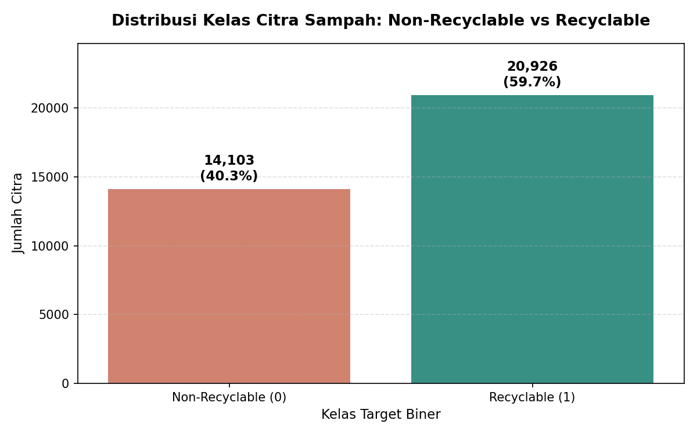
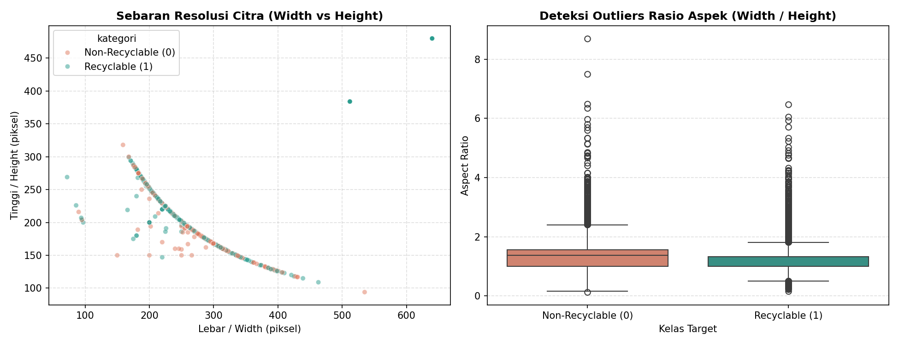
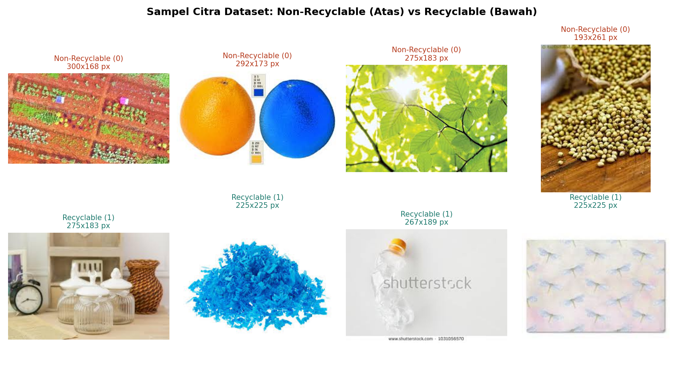

## INFORMASI PROYEK

**Judul Proyek:**  
Penerapan Computer Vision dalam Klasifikasi Biner Citra Sampah Recyclable vs Non-Recyclable Guna Pemilahan Otomatis pada Bank Sampah

**Anggota Kelompok:**

| No | Nama Mahasiswa | NIM |
|:--:|---|---|
| 1 | Arie Dwi Sulistyo | 244311005 |
| 2 | Jimli Dwi Assiddiqi | 244311015 |

**Program Studi:** Teknologi Rekayasa Perangkat Lunak  
**Mata Kuliah:** Data Science  
**Dosen Pengampu:** Gus Nanang Syaifuddiin, S.Kom., M.Kom.  
**Tahun Akademik:** 2026/2027  Semester 5  
**Link GitHub Repository:** [https://github.com/ArDS1401/smart-trash-cv](https://github.com/ArDS1401/smart-trash-cv)  
**Link Video Pembahasan:** [URL Video (YouTube/Drive)]  
**SDG yang Dipilih:** [SDG 12 – Konsumsi dan Produksi yang Bertanggung Jawab (*Responsible Consumption and Production*)](https://sdgs.un.org/goals/goal12)  
**Target SDG yang Relevan:** [Target 12.5 – *By 2030, substantially reduce waste generation through prevention, reduction, recycling and reuse* (Pada tahun 2030, secara substansial mengurangi produksi limbah melalui pencegahan, pengurangan, daur ulang, dan penggunaan kembali)](https://sdgs.un.org/2030agenda)
## 0. KERANGKA ML LIFECYCLE (L-M-O-P)

Laporan ini disusun mengikuti **ML Lifecycle** yang terdiri dari empat tahap berulang (iteratif):

| Tahap | Singkatan | Inti Pertanyaan | Bagian Laporan | 
| ----- | ----- | ----- | ----- | 
| **Learning Problem** | **L** | Apa target, objective, dan datanya? | Bab 2, 3, 4, 5 | 
| **Model Design** | **M** | Model family/arsitektur apa, hypothesis space, dan inductive bias/asumsi apa? | Bab 6 (6.x.1 – 6.x.3) | 
| **Optimization** | **O** | Bagaimana model dilatih: loss, optimizer, tuning, regularisasi, konvergensi? | Bab 6 (6.x.4 – 6.x.6) | 
| **Predict & Evaluate** | **P** | Seberapa baik prediksi model berdasarkan metrik evaluasi? | Bab 7 | 

```
   L (Learning Problem) ──► M (Model Design) ──► O (Optimization) ──► P (Predict & Evaluate)
          ▲                                                                   │
          └─────────────── iterasi / perbaikan berdasarkan hasil evaluasi ────┘

```

**Catatan untuk mahasiswa:** Setiap bagian diberi label **\[L\]**, **\[M\]**, **\[O\]**, atau **\[P\]**. Pastikan Anda dapat menjelaskan keterkaitan antar tahap, misalnya bagaimana hasil **P** mendorong perbaikan pada **L/M/O** (Bab 7.5).

## 1. LEARNING OUTCOMES

Pada proyek ini, mahasiswa diharapkan dapat:

1. **\[L\]** Mengidentifikasi masalah nyata dari **ide sendiri** yang selaras dengan salah satu tujuan **SDGs** ([Agenda 2030 – sdgs.un.org/2030agenda](https://sdgs.un.org/2030agenda)), lalu merumuskan problem statement (target, objective, data) secara jelas

2. **\[L\]** Melakukan analisis dan eksplorasi data (EDA) secara komprehensif (**OPSIONAL**)

3. **\[L\]** Melakukan data preparation yang sesuai dengan karakteristik dataset

4. **\[M\]** Merancang tiga model machine learning dengan justifikasi hypothesis space dan inductive bias (**WAJIB**):

   * Model baseline

   * Model machine learning / advanced

   * Model deep learning (**WAJIB**)

5. **\[O\]** Mengoptimasi model secara sistematis (loss function, optimizer, hyperparameter tuning, regularisasi)

6. **\[P\]** Menggunakan metrik evaluasi yang relevan dengan jenis tugas ML dan menganalisis hasilnya

7. Melaporkan hasil eksperimen secara ilmiah dan sistematis

8. Mengunggah seluruh kode proyek ke GitHub (**WAJIB**)

9. Menerapkan prinsip software engineering dalam pengembangan proyek

## 2. PROJECT OVERVIEW  **\[L\]**

### 2.1 Latar Belakang

**Isi bagian ini dengan:**

* Mengapa proyek ini penting?

* Permasalahan umum pada domain terkait (misal: kesehatan, pendidikan, keuangan, pertanian, NLP, computer vision, dll.)

* Manfaat proyek untuk pengguna, bisnis, atau penelitian

* Studi literatur atau referensi ilmiah (minimal 1–2 sumber wajib)

* Keterkaitan masalah dengan SDGs yang dipilih (dijabarkan di Bab 2.2)

**Contoh referensi (berformat APA/IEEE):**

> Goodfellow, I., Bengio, Y., & Courville, A. (2016). *Deep Learning*. MIT Press.

Peningkatan volume timbulan sampah rumah tangga menjadi tantangan krusial bagi pengelolaan lingkungan perkotaan dan fasilitas **Bank Sampah**. Pada domain *Computer Vision* dan pengelolaan limbah, proses pemilahan antara sampah yang dapat didaur ulang (*recyclable*, seperti botol plastik, kaca, logam, kertas, dan kardus bersih) dengan sampah yang tidak dapat didaur ulang secara langsung di fasilitas daur ulang anorganik (*non-recyclable*, seperti sampah organik basah dan residu terkontaminasi) di banyak Bank Sampah masih dilakukan secara manual oleh petugas. Pemilahan manual membutuhkan waktu lama, rentan terhadap kelelahan dan subjektivitas manusia, serta menimbulkan risiko kesehatan kerja. Selain itu, tercampurnya sampah organik atau residu ke dalam fraksi *recyclable* menurunkan nilai jual material daur ulang akibat kontaminasi silang (tingkat penerimaan pilahan awal yang bersih sering kali hanya berkisar 30%).

Proyek **"Penerapan Computer Vision dalam Klasifikasi Biner Citra Sampah Recyclable vs Non-Recyclable Guna Pemilahan Otomatis pada Bank Sampah"** ini penting karena pemanfaatan *Computer Vision* berbasis *Machine Learning* (ML) dan *Deep Learning* (DL) memungkinkan otomatisasi identifikasi jenis sampah dari citra kamera secara cepat, konsisten, dan objektif. Manfaat proyek ini bagi operasional Bank Sampah dan masyarakat adalah mempercepat proses *pre-sorting* saat penerimaan setoran sampah, menekan tingkat kontaminasi pada fraksi daur ulang, serta mendukung pencapaian [SDG 12 Target 12.5](https://sdgs.un.org/goals/goal12). Studi oleh [Nnamoko et al. (2022)](https://www.mdpi.com/2412-3811/7/4/47) menunjukkan bahwa arsitektur *Convolutional Neural Network* (CNN) mampu memisahkan citra sampah padat rumah tangga menjadi kelas organik dan *recyclable* secara akurat pada dataset [Waste Classification Data](https://data.mendeley.com/datasets/n3gtgm9jxj/2). Sejalan dengan itu, penelitian [Bircanoğlu et al. (2018)](https://open.metu.edu.tr/handle/11511/67997), [Wang et al. (2020)](https://pmc.ncbi.nlm.nih.gov/articles/PMC7411711/), dan [Yang & Thung (2016)](https://github.com/garythung/trashnet) membuktikan efektivitas ekstraksi fitur spasial dan *transfer learning* pada citra sampah untuk mendukung sistem pemilahan otomatis (*intelligent waste sorting*).

**Referensi Ilmiah (Format APA):**

> 1. Nnamoko, N., Barrowclough, J., & Procter, J. (2022). Solid Waste Image Classification Using Deep Convolutional Neural Network. *Informatics*, 7(4), 47. <https://www.mdpi.com/2412-3811/7/4/47>
>
> 2. Bircanoğlu, C., Atay, M., Beşer, F., Genç, Ö., & Kızrak, M. A. (2018). RecycleNet: Intelligent Waste Sorting Using Deep Neural Networks. In *2018 IEEE International Conference on Innovations in Intelligent Systems and Applications (INISTA)* (pp. 1–7). IEEE. <https://open.metu.edu.tr/handle/11511/67997>
>
> 3. Wang, T., Cai, Y., Liang, L., & Ye, D. (2020). A Multi-Level Approach to Waste Object Segmentation. *Sensors*, 20(14), 3816. <https://pmc.ncbi.nlm.nih.gov/articles/PMC7411711/>
>
> 4. Yang, M., & Thung, G. (2016). Classification of Trash for Recyclability Status. *CS229 Project Report*, Stanford University. <https://github.com/garythung/trashnet>

### 2.2 Keterkaitan dengan SDGs (WAJIB)

Ide proyek **berasal dari mahasiswa** dan harus selaras dengan **salah satu** dari 17 Sustainable Development Goals (daftar dan contoh inspirasi ada di Lampiran A).

| Komponen | Pertanyaan Panduan | Jawaban Anda | 
| ----- | ----- | ----- | 
| **SDG yang dipilih** | Goal nomor berapa dan apa namanya? | [SDG 12 – Konsumsi dan Produksi yang Bertanggung Jawab (*Ensure sustainable consumption and production patterns*)](https://sdgs.un.org/goals/goal12) | 
| **Target SDG** | Target (misal 3.4, 13.1) mana yang paling relevan? | **Target 12.5**: *"By 2030, substantially reduce waste generation through prevention, reduction, recycling and reuse"* (Pada tahun 2030, secara substansial mengurangi produksi limbah melalui pencegahan, pengurangan, daur ulang, dan penggunaan kembali), khususnya mendukung [Indikator 12.5.1 (*National recycling rate, tons of material recycled*)](https://know-sdgs.jrc.ec.europa.eu/sdg/12). | 
| **Masalah nyata** | Masalah konkret apa yang diangkat? Siapa yang terdampak? | Proses pemilahan sampah di tingkat rumah tangga dan Bank Sampah masih lambat dan kurang akurat sehingga material bernilai daur ulang (*recyclable*) sering tercampur dengan sampah organik/residu (*non-recyclable*). Pihak yang terdampak adalah petugas dan nasabah Bank Sampah, pengelola TPS3R, serta masyarakat di sekitar TPA akibat tingginya volume residu yang gagal didaur ulang. | 
| **Peran ML** | Mengapa ML/DL cocok? Apa keputusan atau proses yang dibantu? | Karakteristik visual objek sampah (tekstur permukaan, pantulan cahaya, bentuk tepi, dan warna) sangat beragam sehingga tidak dapat diselesaikan dengan aturan pemrograman statis (*rule-based*). Model *Computer Vision* berbasis ML/DL mampu mempelajari pola representasi visual dari ribuan citra untuk mengotomatisasi keputusan klasifikasi biner (*Recyclable* vs *Non-Recyclable*) pada proses sortir awal di Bank Sampah. | 
| **Indikator kontribusi** | Bagaimana hasil model berkontribusi pada target SDG (langsung/tidak langsung)? | **Kontribusi langsung:** Mempercepat proses identifikasi dan mengurangi kontaminasi silang antara sampah organik/residu dan sampah daur ulang di Bank Sampah. **Kontribusi tidak langsung:** Meningkatkan persentase tonase material yang layak didaur ulang sesuai [Indikator SDG 12.5.1](https://know-sdgs.jrc.ec.europa.eu/sdg/12) serta menekan volume timbulan sampah yang dibuang ke TPA. | 
| **Pertimbangan etika** | Risiko bias, privasi, atau dampak salah prediksi? | **1. Risiko Bias (*Domain Shift*):** Dataset publik umumnya memiliki latar belakang yang bersih dan pencahayaan terkontrol, sehingga model berisiko mengalami penurunan akurasi pada sampah yang kotor, penyok, atau bertumpuk di kondisi nyata. **2. Privasi:** Kamera pemilah sampah berpotensi menangkap label resi/alamat paket, dokumen pribadi, atau bagian tubuh warga, sehingga sistem harus membatasi tangkapan citra pada area objek sampah dan tidak menyimpan informasi identitas pribadi. **3. Dampak Salah Prediksi:** *False Positive* (sampah *non-recyclable* diprediksi *recyclable*) mengontaminasi wadah daur ulang, sedangkan *False Negative* (sampah *recyclable* diprediksi *non-recyclable*) menyebabkan hilangnya material bernilai ekonomis ke jalur residu. | 

**Sumber ide:** Pengamatan terhadap permasalahan pemilahan sampah di lingkungan sekitar dan operasional Bank Sampah lokal, di mana pencampuran sampah organik/residu dengan sampah daur ulang masih tinggi sehingga menurunkan efisiensi daur ulang (rata-rata tingkat penerimaan pilahan yang benar baru sekitar 30%).

### 2.3 Ringkasan Alur Lifecycle Proyek

Jelaskan dalam 1 paragraf pendek bagaimana proyek Anda melewati tahap L → M → O → P (dan iterasi apa yang direncanakan).

Proyek pada repositori [ArDS1401/smart-trash-cv](https://www.google.com/search?q=https://github.com/ArDS1401/smart-trash-cv) ini diawali pada tahap **Learning Problem \[L\]** dengan merumuskan masalah pemilahan otomatis di Bank Sampah sebagai tugas *Computer Vision* klasifikasi biner citra (*Recyclable* vs *Non-Recyclable*) yang mendukung [SDG 12 Target 12.5](https://sdgs.un.org/goals/goal12), disertai eksplorasi dan *data preparation* (pembersihan mode warna RGB, *resizing*, ekstraksi fitur warna/tekstur, augmentasi, serta *stratified splitting* tanpa *data leakage*) pada dataset citra sampah ([Waste Classification Data](https://www.kaggle.com/datasets/techsash/waste-classification-data/), [MJU-Waste](https://github.com/realwecan/mju-waste), dan [TrashNet](https://huggingface.co/datasets/garythung/trashnet/viewer/default/train)). Selanjutnya pada tahap **Model Design \[M\]**, dirancang tiga model dengan *hypothesis space* dan *inductive bias* berbeda, yaitu *Logistic Regression* sebagai model *baseline* linear, *Random Forest Classifier* berbasis ekstraksi fitur HOG dan *Color Histogram* sebagai model *advanced*, serta *Convolutional Neural Network* (CNN / *Transfer Learning MobileNetV2*) sebagai model *deep learning*. Pada tahap **Optimization \[O\]**, model dilatih dengan meminimalkan *binary cross-entropy loss* (dan *Gini impurity* pada *Random Forest*) disertai pencarian *hyperparameter* (*Grid/Random Search* pada model ML serta eksperimen *learning rate*, *batch size*, dan regularisasi *Dropout* pada CNN) menggunakan *validation set*. Terakhir, pada tahap **Predict & Evaluate \[P\]**, performa ketiga model dievaluasi secara objektif pada *test set* menggunakan metrik Accuracy, Precision, Recall, F1-Score, dan ROC-AUC, di mana hasil *error analysis* akan digunakan sebagai umpan balik iterasi perbaikan menuju tahap **L**, **M**, atau **O** (misalnya penyesuaian *class weight*, penambahan variasi augmentasi pencahayaan, atau *fine-tuning* layer konvolusi).

## 3. BUSINESS UNDERSTANDING / PROBLEM UNDERSTANDING  **\[L\]**

### 3.1 Problem Statements

Tuliskan 2–4 pernyataan masalah yang jelas dan spesifik.

**Contoh (universal):**

1. Model perlu mampu memprediksi nilai target dengan akurasi tinggi

2. Sistem harus dapat mengidentifikasi pola pada citra secara otomatis

3. Dataset memiliki noise sehingga perlu preprocessing yang tepat

4. Dibutuhkan model deep learning yang mampu belajar representasi fitur kompleks

**Problem Statements Proyek:**

1. Pemilahan sampah manual di Bank Sampah membutuhkan waktu lama dan rentan terhadap kesalahan manusia, sehingga diperlukan penerapan *Computer Vision* dengan model klasifikasi biner yang mampu memisahkan citra sampah **Recyclable** dan **Non-Recyclable** secara otomatis dengan tingkat akurasi dan F1-Score yang tinggi.

2. Citra sampah memiliki variasi resolusi, pencahayaan, orientasi, serta inkonsistensi mode warna (seperti adanya citra mode palet pada dataset mentah), sehingga diperlukan tahapan *data preparation* dan ekstraksi fitur yang tepat tanpa menimbulkan *data leakage*.

3. Model linear sederhana memiliki keterbatasan dalam menangkap pola spasial dan tekstur kompleks pada citra sampah, sehingga diperlukan perbandingan sistematis antara model *baseline* (*Logistic Regression*), model *advanced* (*Random Forest*), dan model *deep learning* (CNN / *Transfer Learning*) untuk menemukan arsitektur dengan *inductive bias* paling sesuai.

4. Kesalahan prediksi berupa *False Positive* (sampah non-daur ulang masuk ke kategori daur ulang) dapat mengontaminasi material di Bank Sampah, sedangkan *False Negative* mengurangi volume material yang berhasil didaur ulang, sehingga model harus dioptimalkan untuk menyeimbangkan *Precision* dan *Recall* guna mendukung [Target SDG 12.5](https://sdgs.un.org/goals/goal12).

### 3.2 Formulasi Learning Problem (WAJIB)

Rumuskan masalah dalam kerangka *Learning Problem*:

| Komponen | Pertanyaan Panduan | Jawaban Anda |
|----------|--------------------|--------------|
| **Target** | Apa yang diprediksi? Jenis tugas (klasifikasi biner/multikelas, regresi, forecasting, clustering, dll.)? | **Klasifikasi Biner Citra (*Binary Image Classification*)**: Memprediksi label kelas biner (`0` atau `1`) dari input citra berwarna RGB (ukuran Tinggi × Lebar × 3 channel warna), di mana label **`1` = Recyclable** (sampah dapat didaur ulang) dan label **`0` = Non-Recyclable** (sampah organik atau residu yang tidak dapat didaur ulang). |
| **Objective** | Apa yang dioptimalkan/diminimalkan secara matematis (misal: cross-entropy, MSE)? Metrik keberhasilan utama? | **Fungsi Objektif Matematis:** Meminimalkan nilai kesalahan prediksi menggunakan **Binary Cross-Entropy Loss (Log-Loss)** dengan rumus rata-rata `-(y * log(p) + (1 - y) * log(1 - p))` pada model *Logistic Regression* dan *Deep Learning* (CNN), serta meminimalkan nilai **Gini Impurity** pada percabangan pohon *Random Forest*. **Metrik Keberhasilan Utama:** **F1-Score**, **Precision**, dan **Recall** (untuk menjaga keseimbangan antara pencegahan kontaminasi wadah daur ulang dan penyelamatan material bernilai jual), dilengkapi **Accuracy** dan **ROC-AUC**. |
| **Data** | Sumber, ukuran, jenis, dan asumsi tentang data (i.i.d.? distribusi train vs test?) | **Jenis Data:** Citra digital berwarna (RGB format `.jpg`/`.png`). **Sumber & Ukuran:** (1) [Waste Classification Data – Sashaank Sekar (Kaggle)](https://www.kaggle.com/datasets/techsash/waste-classification-data/) / [Kurasi Mendeley Data](https://data.mendeley.com/datasets/n3gtgm9jxj/2) berukuran **~427 MB** dengan **25.077 citra** (22.564 *train* dan 2.513 *test*; terdiri dari 13.966 *Organic/Non-Recyclable* dan 11.111 *Recyclable*, atau 24.705 citra RGB bersih setelah pembersihan 372 citra mode palet); (2) [MJU-Waste (GitHub)](https://github.com/realwecan/mju-waste) berisi **2.475 pasang citra** RGB-D sampah (1.485 *train*, 248 *val*, 742 *test*); serta (3) [TrashNet Dataset (Hugging Face)](https://huggingface.co/datasets/garythung/trashnet/viewer/default/train) / [GitHub TrashNet](https://github.com/garythung/trashnet) berisi **2.527 citra** dalam 6 kelas (*glass, paper, cardboard, plastic, metal, trash*). **Asumsi Data:** Sampel citra diasumsikan *independent and identically distributed* (i.i.d.) dengan proporsi kelas pada *training*, *validation*, dan *test set* dijaga tetap seimbang (~55,7% *Non-Recyclable* : ~44,3% *Recyclable*) melalui pembagian terstratifikasi (*stratified splitting*). |

### 3.3 Goals

Tujuan harus spesifik, terukur, dan selaras dengan problem statement.
**Contoh tujuan:**

1. Membangun model ML untuk memprediksi variabel target dengan akurasi > 80%

2. Mengukur performa tiga pendekatan model (baseline, advanced, deep learning)

3. Menentukan model terbaik berdasarkan metrik evaluasi yang relevan

4. Menghasilkan sistem yang dapat bekerja secara reproducible

> Sertakan minimal satu goal yang menunjukkan kontribusi terhadap target SDG yang dipilih (Bab 2.2).

**Goals Proyek:**

1. Membangun model *Computer Vision* untuk klasifikasi biner citra sampah (*Recyclable* vs *Non-Recyclable*) yang mampu mencapai **Accuracy > 85%** dan **F1-Score** >= **0,85** pada *test set*.

2. Mengimplementasikan dan membandingkan performa tiga pendekatan model (**Model 1 Baseline**: *Logistic Regression*, **Model 2 Advanced**: *Random Forest Classifier*, dan **Model 3 Deep Learning**: *Convolutional Neural Network / Transfer Learning MobileNetV2*) dari segi metrik evaluasi serta efisiensi waktu komputasi.

3. Menentukan model terbaik berdasarkan analisis komprehensif terhadap *F1-Score*, *Precision*, *Recall*, *ROC-AUC*, dan kesesuaian *inductive bias* terhadap karakteristik data citra sampah.

4. Menghasilkan sistem dan *pipeline* eksperimen yang *reproducible* pada repositori [ArDS1401/smart-trash-cv](https://www.google.com/search?q=https://github.com/ArDS1401/smart-trash-cv) guna mendukung otomatisasi pemilahan sampah pada Bank Sampah sebagai kontribusi nyata terhadap [SDG 12 Target 12.5](https://sdgs.un.org/goals/goal12) dalam menekan tingkat kontaminasi material daur ulang dan mengurangi timbulan residu ke TPA.

### 3.4 Solution Approach  **\[M\]**

Mahasiswa **WAJIB** menggunakan minimal **tiga model** dengan komposisi sebagai berikut:

#### **Model 1 – Baseline Model**

Model sederhana sebagai pembanding dasar.
**Pilihan model:**

* Linear Regression (untuk regresi)

* Logistic Regression (untuk klasifikasi)

* K-Nearest Neighbors (KNN)

* Decision Tree

* Naive Bayes

**Model Baseline yang Dipilih:** **Logistic Regression**

**Alasan Pemilihan:** *Logistic Regression* dipilih sebagai model *baseline* karena merupakan pengklasifikasi biner probabilistik dengan kompleksitas komputasi rendah dan batas keputusan linear (*linear decision boundary*). Dengan menggunakan input berupa fitur statistik warna dasar (histogram warna RGB/HSV atau piksel citra yang telah direduksi), model ini memberikan tolok ukur dasar (*lower-bound benchmark*) untuk mengetahui seberapa baik klasifikasi sampah dapat dilakukan hanya dengan pemisahan linear sebelum menerapkan model non-linear dan *deep learning*.

#### **Model 2 – Advanced / ML Model**

Model machine learning yang lebih kompleks.
**Pilihan model:**

* Random Forest

* Gradient Boosting (XGBoost, LightGBM, CatBoost)

* Support Vector Machine (SVM)

* Ensemble methods

* Clustering (K-Means, DBSCAN) - untuk unsupervised

* PCA / dimensionality reduction (untuk preprocessing)

**Model Advanced yang Dipilih:** **Random Forest Classifier** (dikombinasikan dengan ekstraksi fitur *Histogram of Oriented Gradients* / HOG dan *Color Histogram*)

**Alasan Pemilihan:** *Random Forest* merupakan algoritma *ensemble* berbasis *bagging* dari banyak pohon keputusan (*decision trees*) yang mampu mempelajari batas keputusan non-linear serta interaksi kompleks antara fitur bentuk/tepi objek (HOG) dan distribusi warna (HSV/RGB). Dibandingkan *Logistic Regression*, *Random Forest* lebih tangguh terhadap *noise* pada latar belakang citra, tidak sensitif terhadap skala fitur, serta memiliki mekanisme pengurangan variansi (*variance reduction*) untuk menekan risiko *overfitting*.

#### **Model 3 – Deep Learning Model (WAJIB)**

Model deep learning yang sesuai dengan jenis data.
**Pilihan Implementasi (pilih salah satu sesuai dataset):**
**A. Tabular Data:**

* Multilayer Perceptron (MLP) / Neural Network

* Minimum: 2 hidden layers

* Contoh: prediksi harga, klasifikasi binary/multiclass

**B. Image Data:**

* CNN sederhana (minimum 2 convolutional layers) **ATAU**

* Transfer Learning (ResNet, VGG, MobileNet, EfficientNet) - **recommended**

* Contoh: klasifikasi gambar, object detection

**C. Text Data:**

* LSTM/GRU (minimum 1 layer) **ATAU**

* Embedding + Dense layers **ATAU**

* Pre-trained model (BERT, DistilBERT, Word2Vec)

* Contoh: sentiment analysis, text classification

**D. Time Series:**

* LSTM/GRU untuk sequential prediction

* Contoh: forecasting, anomaly detection

**E. Recommender Systems:**

* Neural Collaborative Filtering (NCF)

* Autoencoder-based Collaborative Filtering

* Deep Matrix Factorization

**Minimum Requirements untuk Deep Learning:**

* ✅ Model harus training minimal 10 epochs

* ✅ Harus ada plot loss dan accuracy/metric per epoch

* ✅ Harus ada hasil prediksi pada test set

* ✅ Training time dicatat (untuk dokumentasi)

**Tidak Diperbolehkan:**

* ❌ Copy-paste kode tanpa pemahaman

* ❌ Model tidak di-train (hanya define arsitektur)

* ❌ Tidak ada evaluasi pada test set

**Model Deep Learning yang Dipilih:** **Convolutional Neural Network (CNN) berbasis Transfer Learning (MobileNetV2)**

**Alasan Pemilihan:** Sesuai karakteristik **B. Image Data**, arsitektur CNN memiliki *inductive bias* berupa *spatial locality* dan *translation invariance* yang mampu mengekstrak representasi fitur visual secara hierarkis (mulai dari tepi dan tekstur lokal hingga bentuk utuh objek sampah) langsung dari piksel citra. Pendekatan *Transfer Learning* menggunakan **MobileNetV2** (*pre-trained* pada ImageNet) dipilih karena menggunakan *depthwise separable convolutions* yang ringan dan efisien untuk dilatih di Google Colab/Kaggle (minimal >= 10 epochs), namun memberikan akurasi tinggi dan kecepatan inferensi yang sangat ideal untuk skenario penerapan *Computer Vision* di Bank Sampah.

## 4. DATA UNDERSTANDING  **[L]**

### 4.1 Informasi Dataset

#### 4.1.1. Waste Classification Data

**Sumber Dataset:**  
Dataset diperoleh dari repositori publik **Kaggle** pada proyek *Waste Classification Data* oleh Sashaank Sekar.  
- **URL**: [https://www.kaggle.com/datasets/techsash/waste-classification-data/](https://www.kaggle.com/datasets/techsash/waste-classification-data/)
- **Lisensi**: CC BY-SA 4.0 (*Creative Commons Attribution-ShareAlike 4.0 International*)

**Deskripsi Dataset:**

- **Jumlah baris (rows / sampel citra)**: 25.077 citra mentah.
- **Jumlah kolom (columns/features)**: Terdiri dari **data piksel citra RGB** dan **2 label kelas folder** (`O`: *Organic*, `R`: *Recyclable*) yang diturunkan menjadi **8 kolom metadata** (termasuk target biner `0`/`1`).
- **Tipe data**: Image Data (Citra Digital RGB, mencakup 372 citra non-RGB sebelum standardisasi warna).
- **Ukuran dataset**: ± 427 MB.
- **Format file**: `.jpg`.

---

#### 4.1.2. TrashNet Dataset

**Sumber Dataset:**  
Dataset diperoleh dari repositori publik **GitHub** pada proyek *TrashNet* oleh Gary Thung dan Mindy Yang (Stanford CS 229).  
- **URL**: [https://github.com/garythung/trashnet](https://github.com/garythung/trashnet)
- **Lisensi**: MIT License

**Deskripsi Dataset:**

- **Jumlah baris (rows / sampel citra)**: 2.527 citra mentah.
- **Jumlah kolom (columns/features)**: Terdiri dari **data piksel citra RGB** dan **6 label kelas folder** (*paper, glass, plastic, metal, cardboard, trash*) yang diturunkan menjadi **8 kolom metadata** (termasuk target biner `0`/`1`).
- **Tipe data**: Image Data (Citra Digital RGB).
- **Ukuran dataset**: ± 42,8 MB.
- **Format file**: `.jpg`.

---

#### 4.1.3. MJU-Waste Dataset v1.0

**Sumber Dataset:**  
Dataset diperoleh dari repositori publik **GitHub** pada proyek *MJU-Waste* oleh Tao Wang et al. (*Minjiang University*).  
- **URL**: [https://github.com/realwecan/mju-waste](https://github.com/realwecan/mju-waste)
- **Lisensi**: MIT License

**Deskripsi Dataset:**

- **Jumlah baris (rows / sampel citra)**: **2.475 citra bersih** (`JPEGImages`).
- **Jumlah kolom (columns/features)**: Terdiri dari **citra RGB**, *depth map*, dan *segmentation mask*, dengan **citra RGB** diambil dan diturunkan menjadi **8 kolom metadata** (target biner `1`: *Recyclable*).
- **Tipe data**: Image Data (Citra Digital RGB).
- **Ukuran dataset**: ± 1,45 GB (arsip lengkap multi-modalitas).
- **Format file**: `.jpg` (citra RGB), `.png` (*depth map* & masker segmentasi), dan `.txt` (indeks partisi).

**Distribusi Sampel Citra RGB Mentah Berdasarkan Sumber Dataset:**

| Sumber Dataset | Jumlah Citra Mentah | Persentase | Citra Bersih (Pasca-Deduplikasi) |
|:---|:---:|:---:|:---:|
| **Waste Classification (Kaggle)** | 25.077 | 83,37% | 24.751 |
| **TrashNet (GitHub)** | 2.527 | 8,40% | 2.524 |
| **MJU-Waste (Google Drive)** | 2.475 | 8,23% | 2.475 |
| **Total Keseluruhan** | **30.079** | **100,00%** | **29.750** |

> *Catatan: Arsip mentah MJU-Waste memuat total 7.425 berkas, namun 4.950 berkas di antaranya merupakan peta kedalaman (`DepthImages`) dan masker segmentasi (`SegmentationClass`) sehingga hanya 2.475 citra warna RGB pada folder `JPEGImages` yang digunakan.*

---

### 4.2 Deskripsi Fitur

Jelaskan setiap fitur/kolom yang ada dalam dataset.
**Contoh tabel:**
| Nama Fitur | Tipe Data | Deskripsi | Contoh Nilai |
|------------|-----------|-----------|--------------|
| id | Integer | ID unik data | 1, 2, 3 |
| age | Integer | Usia (tahun) | 25, 30, 45 |
| income | Float | Pendapatan (juta) | 5.5, 10.2 |
| category | Categorical | Kategori produk | A, B, C |
| text | String | Teks ulasan | "Produk bagus..." |
| image | Image | Citra 224x224 RGB | Array 224x224x3 |
| label | Categorical | Label target | 0, 1 atau "positif", "negatif" |

**[Buat tabel deskripsi fitur Anda di sini]**

| Nama Fitur | Tipe Data | Deskripsi | Contoh Nilai |
|------------|-----------|-----------|--------------|
| `image` | Image (3D Array) | Citra digital sampah dalam ruang warna RGB 3-channel | Array `(H, W, 3)` dengan intensitas `0–255` |
| `filename` | String | Nama berkas citra `.jpg` yang telah tervalidasi | `"O_12568.jpg"`, `"cardboard12.jpg"` |
| `filepath` | String | Lokasi path berkas citra pada direktori penyimpanan sistem | `"/content/data/converted_rgb/..."` |
| `source` | Categorical | Nama repositori sumber dataset asal | `"Waste_Classification"`, `"TrashNet"`, `"MJU_Waste"` |
| `raw_class` | Categorical | Nama kelas atau kategori asli dari folder dataset sumber | `"O"`, `"R"`, `"plastic"`, `"JPEGImages"` |
| `width` | Integer | Lebar resolusi citra dalam satuan piksel | `225`, `259`, `512` |
| `height` | Integer | Tinggi resolusi citra dalam satuan piksel | `183`, `194`, `384` |
| `target` *(target)* | Integer (Binary) | Label target numerik untuk klasifikasi biner | `0` (*Non-Recyclable*), `1` (*Recyclable*) |
| `severity_label` *(target)* | Categorical | Label deskriptif kelas target hasil pemetaan biner | `"Non-Recyclable"`, `"Recyclable"` |

---

### 4.3 Kondisi Data

Berdasarkan hasil pemindaian terprogram pada seluruh 35.029 citra gabungan[cite: 19], ditemukan kondisi dan permasalahan data sebagai berikut:

- **Missing Values:** **Sangat minim / hampir tidak ada**. Hanya terdapat **1 file** yang terdeteksi *corrupted* atau bermasalah dari total 35.029 citra.
- **Duplicate Data:** **Ada, sebanyak 336 citra duplikat (0,96% dari total data gabungan)** berdasarkan pemeriksaan nilai *hash* MD5 yang identik antar file. Citra duplikat ini dibersihkan pada tahap *Data Cleaning* untuk mencegah kebocoran data (*data leakage*) antar subset.
- **Outliers:** **Ada, pada atribut dimensi resolusi (`width`, `height`) dan `aspect_ratio`**. Mayoritas citra berada pada rentang kuartil 25%–75% (`width` 225–512 px, `height` 183–384 px). Namun, ditemukan nilai ekstrem (*outliers*) dengan rasio aspek (*aspect ratio*) mencapai **8,70** maupun ukuran file maksimum hingga **559,59 KB**, sehingga proses penyeragaman ukuran (*resizing*) mutlak diperlukan sebelum masuk ke tahap pemodelan.
- **Imbalanced Data:** **Ada (ketidakseimbangan kelas ringan / *mild imbalance*)** dengan total **14.103 citra Non-Recyclable (40,3%)** berbanding **20.926 citra Recyclable (59,7%)**. Kondisi ini dikelola melalui strategi *stratified splitting*, penyesuaian bobot kelas (*class weight*), serta penggunaan metrik evaluasi **F1-Score**.
- **Noise & Variasi Lingkungan:** **Ada**. Citra gabungan memiliki latar belakang yang beragam (seperti kondisi ruangan, alam, meja, hingga variasi pencahayaan dan sudut ambil gambar).
- **Data Quality Issues:** **Inkonsistensi Mode Warna (*Color Mode*)**. Sebagian kecil citra menggunakan format selain standar RGB 3-channel, yang memerlukan penanganan konversi otomatis agar tidak menimbulkan *error* dimensi matriks saat ekstraksi fitur maupun pelatihan model CNN.
- **Asumsi Data (i.i.d., distribusi train-test, potensi data leakage):** Sampel citra diasumsikan *independent and identically distributed* (i.i.d.). Potensi *data leakage* diantisipasi dengan mendeteksi dan menghapus duplikat *hash* MD5 serta memastikan proses *scaling* atau normalisasi hanya diterapkan setelah pemisahan data latih dan uji.

---

### 4.4 Exploratory Data Analysis (EDA) - (**OPSIONAL**)

### Visualisasi 1: Distribusi Kelas Citra Sampah (Non-Recyclable vs Recyclable)


**Insight:**  
Berdasarkan grafik batang di atas, kelas **Non-Recyclable (0)** memiliki jumlah sampel sebanyak **14.103 citra (40,3%)**, sedangkan kelas **Recyclable (1)** berjumlah **20.926 citra (59,7%)**. Ketidakseimbangan kelas ini menunjukkan bahwa evaluasi performa model tidak boleh hanya bergantung pada *Accuracy*, melainkan wajib dilengkapi dengan **Precision, Recall, dan F1-Score**, serta pembagian data harus menggunakan teknik **Stratified Split** agar proporsi kelas tetap terjaga di setiap subset.

### Visualisasi 2: Sebaran Resolusi Citra (Width vs Height) dan Deteksi Outliers Rasio Aspek


**Insight:**  
Plot sebaran (*scatter plot*) di sebelah kiri memperlihatkan variasi sebaran dimensi piksel dari gabungan berbagai sumber dataset eksternal. Sementara itu, *boxplot* di sebelah kanan mendeteksi sejumlah titik *outliers* dengan *aspect ratio* ekstrem (mencapai batas atas hingga 8,70). Temuan ini memperkuat alasan mengapa tahap *Data Transformation* wajib menerapkan proses **Resizing** ke dimensi seragam (misalnya `224x224` piksel) agar ukuran tensor input ke model menjadi konsisten.

#### Visualisasi 3: Sampel Citra Dataset per Kelas (Non-Recyclable vs Recyclable)


**Insight:**  
Dari perbandingan sampel visual kedua kelas, terlihat perbedaan karakteristik warna dan struktur bentuk yang jelas:
1. **Kelas Non-Recyclable (0)** (baris atas: sayuran, buah jeruk, daun, biji-bijian) didominasi oleh tekstur organik yang tidak beraturan serta spektrum warna hangat/alami (cokelat, hijau daun, oranye).
2. **Kelas Recyclable (1)** (baris bawah: botol plastik, gelas kaca, serpihan plastik biru, kemasan) memiliki garis tepi geometris yang tegas, permukaan yang memantulkan cahaya (kilap plastik/kaca), serta kontras warna buatan yang tajam.
Perbedaan karakteristik ini memvalidasi keputusan desain fitur pada proyek kami, yaitu menggabungkan **Color Histogram** (untuk menangkap perbedaan spektrum warna organik vs anorganik) dan **HOG / Convolutional Layers** (untuk menangkap pola garis tepi geometris pada objek daur ulang).

## 5. DATA PREPARATION  **\[L\]**

Bagian ini menjelaskan **semua** proses transformasi dan preprocessing data yang dilakukan.

### 5.1 Data Cleaning

**Aktivitas:**

* Handling missing values

* Removing duplicates

* Handling outliers

* Data type conversion
  **Contoh:**

```
Missing Values:
- Fitur 'age' memiliki 50 missing values (5% dari data)
- Strategi: Imputasi dengan median karena distribusi skewed
- Alasan: Median lebih robust terhadap outliers dibanding mean

```

**\[Jelaskan langkah-langkah data cleaning yang Anda lakukan\]**

```
1. Validasi Direktori & Integritas Berkas Citra:
  - Menyaring hanya direktori citra RGB yang valid, lalu memeriksa keterbacaan seluruh file.
2. Standarisasi Ruang Warna (RGB 3-Channel):
  - Mengonversi citra berformat non-RGB (mode palet `P`, transparan `RGBA`, dan *grayscale* `L`) ke standar RGB 3-channel serta menyimpan hasil konversinya agar tidak memicu error decoding pada pipeline TensorFlow.
3. Penghapusan Duplikat:
  - Melakukan pengecekan MD5 hash pada byte piksel RGB setiap citra untuk menghapus citra duplikat identik yang berpotensi menyebabkan bias evaluasi atau kebocoran data (data leakage) lintas partisi.
```

### 5.2 Feature Engineering

**Aktivitas:**

* Creating new features

* Feature extraction

* Feature selection

* Dimensionality reduction

**\[Jelaskan feature engineering yang Anda lakukan\]**

Pada tahap ini dilakukan pembentukan label target biner serta ekstraksi fitur numerik terstruktur dari citra sampah untuk kebutuhan pelatihan model *Machine Learning* klasik:

1. **Creating New Features (*Target Derivation*):**
   - Menyeragamkan seluruh label kategori asal dari tiga repositori dataset ke dalam variabel target klasifikasi biner baru (`target` $\in \{0, 1\}$) beserta label deskriptifnya (`severity_label`):
     - **Kelas `0` (*Non-Recyclable*):** Dipetakan dari kategori `O` (*Organic*) pada *Waste Classification Data* dan kategori `trash` pada *TrashNet* (total **13.788 citra**).
     - **Kelas `1` (*Recyclable*):** Dipetakan dari kategori `R` (*Recyclable*) pada *Waste Classification Data*, lima kategori daur ulang (`cardboard`, `glass`, `metal`, `paper`, `plastic`) pada *TrashNet*, serta seluruh citra pada folder `JPEGImages` *MJU-Waste* (total **15.962 citra**).

2. **Feature Extraction (Vektor Fitur Klasik 6.180 Dimensi):**
   - Setiap citra diseragamkan ukurannya menjadi $224 \times 224$ piksel dan diekstrak menjadi vektor fitur numerik bertipe `float32` dengan total **6.180 fitur**:
     - **Color Histogram RGB (96 fitur — indeks `0:96`):** Menghitung distribusi intensitas warna pada 3 kanal warna (B, G, R) dengan masing-masing 32 *bins* ($3 \times 32 = 96$ fitur) yang dinormalisasi menggunakan `cv2.normalize`. Fitur ini digunakan secara khusus sebagai input **Model 1 (*Baseline Logistic Regression*)**.
     - **Histogram of Oriented Gradients / HOG (6.084 fitur — indeks `96:6180`):** Mengekstrak informasi bentuk, kontur, dan gradien tepi objek pada citra *grayscale* menggunakan `skimage.feature.hog` (`orientations=9`, `pixels_per_cell=(16, 16)`, `cells_per_block=(2, 2)`, `block_norm="L2-Hys"`). Gabungan **96 fitur warna + 6.084 fitur HOG (total 6.180 fitur)** digunakan oleh **Model 2 (*Advanced Random Forest*)**.

---

### 5.3 Data Transformation

**Untuk Data Tabular:**

* Encoding (Label Encoding, One-Hot Encoding, Ordinal Encoding)

* Scaling (Standardization, Normalization, MinMaxScaler)

**Untuk Data Text:**

* Tokenization

* Lowercasing

* Removing punctuation/stopwords

* Stemming/Lemmatization

* Padding sequences

* Word embedding (Word2Vec, GloVe, fastText)

**Untuk Data Image:**

* Resizing

* Normalization (pixel values 0-1 atau -1 to 1)

* Data augmentation (rotation, flip, zoom, brightness, etc.)

* Color space conversion

**Untuk Time Series:**

* Creating time windows

* Lag features

* Rolling statistics

* Differencing

**\[Jelaskan transformasi yang Anda lakukan\]**

1. **Transformasi Data Tabular (`StandardScaler`):**
   - Matriks fitur klasik mentah berukuran `(20825, 6180)` distandardisasi menggunakan `StandardScaler()` ($\mu = 0, \sigma = 1$) agar seluruh fitur histogram warna dan gradien HOG memiliki skala seragam sebelum dilatih pada algoritma berbasis optimasi gradien (*Logistic Regression*).
   - Proses `fit_transform()` dijalankan **hanya pada `X_train_raw`**, sedangkan `X_val_raw` `(4462, 6180)` dan `X_test_raw` `(4463, 6180)` hanya dikenai `transform()`. Seluruh matriks hasil transformasi disimpan ke `classical_features.npz` dan objek *scaler* disimpan ke `standard_scaler.joblib`.

2. **Transformasi & Augmentasi Data Image (`tf.data` Pipeline):**
   - **Color Space Conversion & Resizing:** Sebanyak 372 citra non-RGB dikonversi menjadi RGB 3-channel pada tahap pembersihan, kemudian seluruh citra diubah ukurannya menjadi `(224, 224, 3)` dengan konfigurasi `BATCH_SIZE = 32` dan `prefetch(tf.data.AUTOTUNE)`.
   - **Normalization:** Intensitas piksel `[0, 255]` dinormalisasi ke rentang **`[-1.00, 1.00]`** menggunakan `tf.keras.applications.mobilenet_v2.preprocess_input` agar sesuai dengan distribusi pralatih arsitektur *MobileNetV2*.
   - **Data Augmentation (*Training Only*):** Diterapkan secara *on-the-fly* hanya pada `train_ds` (`seed=42`) menggunakan lapisan `RandomFlip("horizontal_and_vertical")`, `RandomRotation(0.2)`, `RandomZoom(0.15)`, dan `RandomContrast(0.15)` untuk memperkaya variasi orientasi serta pencahayaan objek sampah, sementara `val_ds` dan `test_ds` dibiarkan tanpa augmentasi.

---

### 5.4 Data Splitting

**Strategi pembagian data:**

```
- Training set: [X]% ([jumlah] samples)
- Validation set: [X]% ([jumlah] samples) - jika ada
- Test set: [X]% ([jumlah] samples)

```

**Contoh:**

```
Menggunakan stratified split untuk mempertahankan distribusi kelas:
- Training: 80% (8000 samples)
- Test: 20% (2000 samples)
- Random state: 42 untuk reproducibility

```

> **Penting:** Test set hanya digunakan **sekali** pada tahap P (evaluasi akhir). Tuning pada tahap O hanya boleh memakai validation set / cross-validation. Fit scaler/encoder hanya pada data training untuk menghindari data leakage.

**\[Jelaskan strategi splitting Anda dan alasannya\]**

```
Dataset dibagi menjadi tiga partisi terpisah dengan random_state = 42 untuk menjamin reproducibility:
- Training set   : 70% (20.825 samples) -> Non-Recyclable: 9.652 | Recyclable: 11.173
- Validation set : 15% (4.462 samples)  -> Non-Recyclable: 2.068 | Recyclable: 2.394
- Test set       : 15% (4.463 samples)  -> Non-Recyclable: 2.068 | Recyclable: 2.395
```

> Pembagian dataset dilakukan **sebelum** proses *feature scaling* dan perhitungan bobot kelas menggunakan fungsi `train_test_split` dua tahap (`70% : 30%`, lalu `30%` dibagi `50% : 50%` menjadi `15%` validasi dan `15%` uji). Stratifikasi diterapkan pada kolom gabungan **`source + "_" + target`** agar setiap partisi (`train_meta.csv`, `val_meta.csv`, dan `test_meta.csv`) memiliki proporsi sampel yang identik baik dari sisi asal repositori maupun kelas biner (*46,35% Non-Recyclable* dan *53,65% Recyclable*).

---

### 5.5 Data Balancing (jika diperlukan)

**Teknik yang digunakan:**

* SMOTE (Synthetic Minority Over-sampling Technique)

* Random Undersampling

* Class weights

* Ensemble sampling

**\[Jelaskan jika Anda melakukan data balancing\]**

Setelah penggabungan tiga sumber dataset, proporsi kelas pada *training set* tergolong relatif seimbang (**46,35% *Non-Recyclable*** berbanding **53,65% *Recyclable***). 
Oleh karena itu, penyeimbangan data dilakukan tanpa menduplikasi atau menghapus sampel fisik, melainkan menggunakan pembobotan kelas otomatis (`compute_class_weight(class_weight="balanced")`) yang dihitung **hanya dari label training (`y_train`)** dan disimpan ke `class_weights.json`:

- **Class Weight `0` (*Non-Recyclable*):** **`1.0788`** (memberikan penalti kesalahan sedikit lebih besar karena jumlah sampelnya lebih sedikit).
- **Class Weight `1` (*Recyclable*):** **`0.9319`** (menyesuaikan penalti secara proporsional terhadap kelas mayoritas).

---

### 5.6 Ringkasan Data Preparation

**Per langkah, jelaskan:**

1. **Data Cleaning**
   - **Apa yang dilakukan:** Menyaring direktori citra RGB yang valid dari 3 sumber dataset (30.079 citra mentah), memeriksa integritas file (0 rusak), mengonversi 372 citra non-RGB ke RGB 3-channel, serta menghapus 329 citra duplikat identik hingga tersisa **29.750 citra bersih**.
   - **Mengapa penting:** Mencegah *error* pembacaan dimensi kanal warna pada *pipeline* TensorFlow serta menghilangkan risiko kebocoran data (*data leakage*) akibat gambar kembar identik yang masuk ke partisi *train* dan *test*.
   - **Bagaimana implementasinya:** Memvalidasi file dengan `PIL.Image`, mengonversi mode warna selain `RGB` ke `/content/data/converted_rgb/`, dan menyaring duplikat berdasarkan nilai *hash* MD5 dari *byte* piksel RGB.

2. **Feature Engineering & Target Derivation**
   - **Apa yang dilakukan:** Menyeragamkan 8 label kategori asal menjadi label biner `0` (*Non-Recyclable*) dan `1` (*Recyclable*), serta mengekstrak **6.180 fitur numerik** (96 fitur *Color Histogram RGB* dan 6.084 fitur *HOG*) untuk setiap citra.
   - **Mengapa penting:** Menyelaraskan skema label yang berbeda antar-dataset serta menyediakan representasi fitur distribusi warna dan bentuk tepi objek bagi model *Machine Learning* klasik.
   - **Bagaimana implementasinya:** Pemetaan aturan berbasis folder sumber (`O`/`trash` -> `0`; `R`/material daur ulang/`MJU-Waste` -> `1`), serta ekstraksi histogram 32 *bins* per kanal (`OpenCV`) dan gradien tepi HOG (`scikit-image`) pada citra 224 x 224.

3. **Data Splitting**
   - **Apa yang dilakukan:** Membagi 29.750 citra bersih menjadi **20.825 *Training* (70%)**, **4.462 *Validation* (15%)**, dan **4.463 *Test* (15%)** sebelum transformasi statistik dilakukan.
   - **Mengapa penting:** Memastikan evaluasi hyperparameter pada *validation set* berlangsung objektif serta menjaga *test set* terisolasi sepenuhnya untuk pengujian akhir.
   - **Bagaimana implementasinya:** Menggunakan `train_test_split` (`random_state=42`) dengan stratifikasi gabungan kolom `source + "_" + target`, lalu menyimpan metadata masing-masing partisi ke `train_meta.csv`, `val_meta.csv`, dan `test_meta.csv`.

4. **Data Transformation & Augmentation**
   - **Apa yang dilakukan:** Melakukan standardisasi skala (`StandardScaler`) pada 6.180 fitur klasik, serta mengubah ukuran citra ke `(224, 224, 3)`, menormalisasi nilai piksel ke `[-1.00, 1.00]`, dan menerapkan augmentasi spasial/warna pada *pipeline* citra *training*.
   - **Mengapa penting:** Mempercepat konvergensi model linier, menyesuaikan skala input citra dengan bobot pralatih *MobileNetV2*, dan meningkatkan ketahanan model terhadap variasi orientasi maupun pencahayaan.
   - **Bagaimana implementasinya:** Menjalankan `fit_transform` `StandardScaler` hanya pada `X_train_raw` (`classical_features.npz`), serta menyusun *pipeline* `tf.data.Dataset` dengan `mobilenet_v2.preprocess_input` dan layer `RandomFlip`, `RandomRotation`, `RandomZoom`, serta `RandomContrast` khusus `train_ds`.

5. **Data Balancing**
   - **Apa yang dilakukan:** Menghitung bobot kelas seimbang untuk fungsi kerugian (*loss function*), menghasilkan bobot **`1.0788`** untuk kelas `0` (*Non-Recyclable*) dan **`0.9319`** untuk kelas `1` (*Recyclable*).
   - **Mengapa penting:** Mengatasi selisih proporsi kelas (*46,35% vs 53,65%*) agar model tidak bias memprediksi kelas mayoritas tanpa merusak distribusi asli data validasi dan pengujian.
   - **Bagaimana implementasinya:** Menggunakan `compute_class_weight(class_weight="balanced")` secara eksklusif pada `y_train` dan menyimpan hasilnya ke berkas `class_weights.json`.

## 6. MODELING  **\[M + O\]**

> Setiap model (6.1, 6.2, 6.3) dijelaskan dalam dua fase: **Model Design \[M\]** (sub-bagian .1–.3) dan **Optimization \[O\]** (sub-bagian .4–.6).

### 6.1 Model 1 — Baseline Model

#### 6.1.1 Deskripsi Model  **\[M\]**

**Nama Model: Logistic Regression** 

**Teori Singkat:**

\[Jelaskan secara singkat bagaimana model ini bekerja\]

**Alasan Pemilihan:**

\[Mengapa memilih model ini sebagai baseline?\]

#### 6.1.2 Hypothesis Space & Inductive Bias  **\[M\]**

* **Model family / arsitektur:** \[misal: model linear\]

* **Hypothesis space:** \[himpunan fungsi yang dapat direpresentasikan, misal: batas keputusan linear\]

* **Inductive bias / asumsi:** \[misal: hubungan fitur-target linear, fitur independen\]

* **Implikasi terhadap dataset Anda:** \[apakah asumsi cocok dengan data?\]

#### 6.1.3 Implementasi (Ringkas)  **\[M\]**

```
# Contoh kode (opsional, bisa dipindah ke GitHub)
from sklearn.linear_model import LogisticRegression

model_baseline = LogisticRegression(C=1.0, max_iter=100)
model_baseline.fit(X_train, y_train)
y_pred_baseline = model_baseline.predict(X_test)

```

#### 6.1.4 Optimization: Objective, Hyperparameter & Regularisasi  **\[O\]**

**Objective/loss yang dioptimalkan:** \[misal: log-loss + L2\]

**Parameter yang digunakan:**

```
[Tuliskan parameter penting, contoh:]
- C (regularization): 1.0
- solver: 'lbfgs'
- max_iter: 100

```

#### 6.1.5 Hasil Awal  **\[O → P\]**

**\[Tuliskan hasil awal pada validation set; evaluasi akhir pada test set dijelaskan di Bab 7\]**

### 6.2 Model 2 — ML / Advanced Model

#### 6.2.1 Deskripsi Model  **\[M\]**

**Nama Model: Random Forest**

**Teori Singkat:**

\[Jelaskan bagaimana algoritma ini bekerja\]

**Alasan Pemilihan:**

\[Mengapa memilih model ini?\]

**Keunggulan:**

* \[Sebutkan keunggulan\]

**Kelemahan:**

* \[Sebutkan kelemahan\]

#### 6.2.2 Hypothesis Space & Inductive Bias  **\[M\]**

* **Model family / arsitektur:** \[misal: ensemble pohon keputusan\]

* **Hypothesis space:** \[fungsi non-linear piecewise, interaksi fitur otomatis, dll.\]

* **Inductive bias / asumsi:** \[misal: data tabular dengan struktur ambang/threshold\]

* **Perbandingan dengan baseline:** \[apa yang bisa dipelajari model ini yang tidak bisa baseline?\]

#### 6.2.3 Implementasi (Ringkas)  **\[M\]**

```
# Contoh kode
from sklearn.ensemble import RandomForestClassifier

model_advanced = RandomForestClassifier(
    n_estimators=100,
    max_depth=10,
    random_state=42
)
model_advanced.fit(X_train, y_train)
y_pred_advanced = model_advanced.predict(X_test)

```

#### 6.2.4 Optimization: Hyperparameter Tuning  **\[O\]**

**Parameter yang digunakan:**

```
[Tuliskan parameter penting, contoh:]
- n_estimators: 100
- max_depth: 10
- learning_rate: 0.1
- min_samples_split: 2

```

**Hyperparameter Tuning (WAJIB minimal 1 metode sederhana):**

* Metode: \[Grid Search / Random Search / Bayesian Optimization\]

* Search space: \[rentang parameter yang dicoba\]

* Skema validasi: \[k-fold CV / validation set\]

* Best parameters: \[...\]

* Skor validasi sebelum vs sesudah tuning: \[...\]

#### 6.2.5 Kontrol Overfitting  **\[O\]**

\[Jelaskan regularisasi/pembatasan kompleksitas yang dipakai, misal: max_depth, min_samples_leaf, early stopping pada boosting\]

#### 6.2.6 Hasil Model  **\[O → P\]**

**\[Tuliskan hasil pada validation set; evaluasi akhir dijelaskan di Bab 7\]**

### 6.3 Model 3 — Deep Learning Model (WAJIB)

#### 6.3.1 Deskripsi Model  **\[M\]**

**Nama Model:** \[Nama arsitektur, misal: CNN / LSTM / MLP\]

 (Centang) Jenis Deep Learning: 

* \[ \] Multilayer Perceptron (MLP) - untuk tabular

* \[ \] Convolutional Neural Network (CNN) - untuk image

* \[ \] Recurrent Neural Network (LSTM/GRU) - untuk sequential/text

* \[ \] Transfer Learning - untuk image

* \[ \] Transformer-based - untuk NLP

* \[ \] Autoencoder - untuk unsupervised

* \[ \] Neural Collaborative Filtering - untuk recommender

**Alasan Pemilihan:**

\[Mengapa arsitektur ini cocok untuk dataset Anda?\]

#### 6.3.2 Arsitektur Model, Hypothesis Space & Inductive Bias  **\[M\]**

**Inductive bias arsitektur:** \[misal: CNN → lokalitas & translation invariance; LSTM → ketergantungan sekuensial; MLP → tanpa asumsi struktur\]

**Hypothesis space:** \[kapasitas model: jumlah layer, unit, parameter\]

**Deskripsi Layer:**

\[Jelaskan arsitektur secara detail atau buat tabel\]

**Contoh:**

```
1. Input Layer: shape (224, 224, 3)
2. Conv2D: 32 filters, kernel (3,3), activation='relu'
3. MaxPooling2D: pool size (2,2)
4. Conv2D: 64 filters, kernel (3,3), activation='relu'
5. MaxPooling2D: pool size (2,2)
6. Flatten
7. Dense: 128 units, activation='relu'
8. Dropout: 0.5
9. Dense: 10 units, activation='softmax'

Total parameters: [jumlah]
Trainable parameters: [jumlah]

```

#### 6.3.3 Input & Preprocessing Khusus  **\[M\]**

**Input shape:** \[Sebutkan dimensi input\]

**Preprocessing khusus untuk DL:**

* \[Sebutkan preprocessing khusus seperti normalisasi, augmentasi, dll.\]

#### 6.3.4 Optimization: Konfigurasi Training  **\[O\]**

**Training Configuration:**

```
- Optimizer: Adam / SGD / RMSprop
- Learning rate: [nilai]
- Loss function: [categorical_crossentropy / mse / binary_crossentropy / etc.]
- Metrics: [accuracy / mae / etc.]
- Batch size: [nilai]
- Epochs: [nilai]
- Validation split: [nilai] atau menggunakan validation set terpisah
- Callbacks: [EarlyStopping, ModelCheckpoint, ReduceLROnPlateau, etc.]
- Regularisasi: [Dropout / L2 / BatchNorm / augmentasi]

```

**Eksperimen optimasi (minimal 2 konfigurasi dibandingkan):**

| Eksperimen | Learning Rate | Batch Size | Regularisasi | Val Loss | Val Metric | 
| ----- | ----- | ----- | ----- | ----- | ----- | 
| Exp-1 | \[ \] | \[ \] | \[ \] | \[ \] | \[ \] | 
| Exp-2 | \[ \] | \[ \] | \[ \] | \[ \] | \[ \] | 

#### 6.3.5 Implementasi (Ringkas)  **\[M + O\]**

**Framework:** TensorFlow/Keras / PyTorch

```
# Contoh kode TensorFlow/Keras
import tensorflow as tf
from tensorflow import keras

model_dl = keras.Sequential([
    keras.layers.Dense(128, activation='relu', input_shape=(input_dim,)),
    keras.layers.Dropout(0.3),
    keras.layers.Dense(64, activation='relu'),
    keras.layers.Dropout(0.3),
    keras.layers.Dense(num_classes, activation='softmax')
])

model_dl.compile(
    optimizer='adam',
    loss='categorical_crossentropy',
    metrics=['accuracy']
)

history = model_dl.fit(
    X_train, y_train,
    validation_split=0.2,
    epochs=50,
    batch_size=32,
    callbacks=[early_stopping]
)

```

#### 6.3.6 Training Process & Diagnosis Optimasi  **\[O\]**

**Training Time:**

\[Sebutkan waktu training total, misal: 15 menit\]

**Computational Resource:**

\[CPU / GPU, platform: Local / Google Colab / Kaggle\]

**Training History Visualization:**

\[Insert plot loss dan accuracy/metric per epoch\]

**Contoh visualisasi yang WAJIB:**

1. **Training & Validation Loss** per epoch

2. **Training & Validation Accuracy/Metric** per epoch

**Analisis Training:**

* Apakah model mengalami overfitting? \[Ya/Tidak, jelaskan\]

* Apakah model sudah converge? \[Ya/Tidak, jelaskan\]

* Apakah perlu lebih banyak epoch? \[Ya/Tidak, jelaskan\]

* Apakah learning rate sesuai (loss stabil/osilasi/lambat)? \[Jelaskan\]

#### 6.3.7 Model Summary

```
[Paste model.summary() output atau rangkuman arsitektur]

```

## 7. EVALUATION  **\[P\]**

### 7.1 Metrik Evaluasi

**Pilih metrik yang sesuai dengan jenis tugas:**

#### **Untuk Klasifikasi:**

* **Accuracy**: Proporsi prediksi yang benar

* **Precision**: TP / (TP + FP)

* **Recall**: TP / (TP + FN)

* **F1-Score**: Harmonic mean dari precision dan recall

* **ROC-AUC**: Area under ROC curve

* **Confusion Matrix**: Visualisasi prediksi

#### **Untuk Regresi:**

* **MSE (Mean Squared Error)**: Rata-rata kuadrat error

* **RMSE (Root Mean Squared Error)**: Akar dari MSE

* **MAE (Mean Absolute Error)**: Rata-rata absolute error

* **R² Score**: Koefisien determinasi

* **MAPE (Mean Absolute Percentage Error)**: Error dalam persentase

#### **Untuk NLP (Text Classification):**

* **Accuracy**

* **F1-Score** (terutama untuk imbalanced data)

* **Precision & Recall**

* **Perplexity** (untuk language models)

#### **Untuk Computer Vision:**

* **Accuracy**

* **IoU (Intersection over Union)** - untuk object detection/segmentation

* **Dice Coefficient** - untuk segmentation

* **mAP (mean Average Precision)** - untuk object detection

#### **Untuk Clustering:**

* **Silhouette Score**

* **Davies-Bouldin Index**

* **Calinski-Harabasz Index**

#### **Untuk Recommender System:**

* **RMSE**

* **Precision@K**

* **Recall@K**

* **NDCG (Normalized Discounted Cumulative Gain)**

**Justifikasi pemilihan metrik:** \[Mengapa metrik ini selaras dengan Objective di Bab 3.2? Mengapa accuracy saja cukup/tidak cukup?\]

### 7.2 Hasil Evaluasi Model (pada Test Set)

> Semua prediksi dievaluasi pada **test set** yang tidak pernah dipakai saat training maupun tuning.

#### 7.2.1 Model 1 (Baseline)

**Metrik:**

```
[Tuliskan hasil metrik, contoh:]
- Accuracy: 0.75
- Precision: 0.73
- Recall: 0.76
- F1-Score: 0.74

```

**Confusion Matrix / Visualization:**

\[Insert gambar jika ada\]

#### 7.2.2 Model 2 (Advanced/ML)

**Metrik:**

```
- Accuracy: 0.85
- Precision: 0.84
- Recall: 0.86
- F1-Score: 0.85

```

**Confusion Matrix / Visualization:**

\[Insert gambar jika ada\]

**Feature Importance (jika applicable):**

\[Insert plot feature importance untuk tree-based models\]

#### 7.2.3 Model 3 (Deep Learning)

**Metrik:**

```
- Accuracy: 0.89
- Precision: 0.88
- Recall: 0.90
- F1-Score: 0.89

```

**Confusion Matrix / Visualization:**

\[Insert gambar jika ada\]

**Training History:**

\[Sudah diinsert di Section 6.3.6\]

**Test Set Predictions:**

\[Tampilkan minimal 5 contoh prediksi benar dan salah\]

### 7.3 Perbandingan Ketiga Model

**Tabel Perbandingan:**

| Model | Accuracy | Precision | Recall | F1-Score | Training Time | Inference Time | 
| ----- | ----- | ----- | ----- | ----- | ----- | ----- | 
| Baseline (Model 1) | 0.75 | 0.73 | 0.76 | 0.74 | 2s | 0.01s | 
| Advanced (Model 2) | 0.85 | 0.84 | 0.86 | 0.85 | 30s | 0.05s | 
| Deep Learning (Model 3) | 0.89 | 0.88 | 0.90 | 0.89 | 15min | 0.1s | 

**Visualisasi Perbandingan:**

\[Insert bar chart atau plot perbandingan metrik\]

### 7.4 Analisis Hasil

**Interpretasi:**

1. **Model Terbaik:**

   \[Sebutkan model mana yang terbaik dan mengapa\]

2. **Perbandingan dengan Baseline:**

   \[Jelaskan peningkatan performa dari baseline ke model lainnya\]

3. **Trade-off:**

   \[Jelaskan trade-off antara performa vs kompleksitas vs waktu training\]

4. **Error Analysis:**

   \[Jelaskan jenis kesalahan yang sering terjadi, kasus yang sulit diprediksi\]

5. **Overfitting/Underfitting & Generalization Gap:**

   \[Bandingkan performa train vs validation vs test; analisis apakah model overfitting atau underfitting\]

6. **Kesesuaian Inductive Bias:**

   \[Apakah asumsi tiap model (Bab 6.x.2) terbukti sesuai dengan data? Jelaskan dengan bukti hasil\]

### 7.5 Umpan Balik Lifecycle (Iterasi L → M → O)

Jelaskan minimal **satu** iterasi perbaikan berdasarkan hasil evaluasi:

| Temuan dari Evaluasi \[P\] | Tahap yang Diperbaiki | Tindakan | Dampak pada Metrik | 
| ----- | ----- | ----- | ----- | 
| \[misal: recall kelas minoritas rendah\] | \[L\] data | \[misal: class weight / SMOTE\] | \[ ... \] | 
| \[misal: gap train-val besar\] | \[O\] optimasi | \[misal: tambah dropout, early stopping\] | \[ ... \] | 
| \[misal: model terlalu sederhana\] | \[M\] desain | \[misal: tambah layer / ganti arsitektur\] | \[ ... \] | 

## 8. CONCLUSION

### 8.1 Kesimpulan Utama

**Model Terbaik:**

\[Sebutkan model terbaik berdasarkan evaluasi\]

**Alasan:**

\[Jelaskan mengapa model tersebut lebih unggul\]

**Pencapaian Goals:**

\[Apakah goals di Section 3.3 tercapai? Jelaskan\]

### 8.2 Key Insights

**Insight dari Data:**

* \[Insight 1\]

* \[Insight 2\]

* \[Insight 3\]

**Insight dari Modeling:**

* \[Insight 1\]

* \[Insight 2\]

### 8.3 Ringkasan per Tahap Lifecycle

| Tahap | Keputusan Kunci | Pelajaran | 
| ----- | ----- | ----- | 
| **L** – Learning Problem | \[ ... \] | \[ ... \] | 
| **M** – Model Design | \[ ... \] | \[ ... \] | 
| **O** – Optimization | \[ ... \] | \[ ... \] | 
| **P** – Predict & Evaluate | \[ ... \] | \[ ... \] | 

### 8.4 Kontribusi Proyek

**Manfaat praktis:**

\[Jelaskan bagaimana proyek ini dapat digunakan di dunia nyata\]

**Kontribusi terhadap SDGs:**

\[Jelaskan secara jujur dan terukur bagaimana hasil proyek mendukung target SDG yang dipilih (Bab 2.2), serta keterbatasan kontribusinya\]

**Pembelajaran yang didapat:**

\[Jelaskan apa yang Anda pelajari dari proyek ini\]

## 9. FUTURE WORK (Opsional)

Saran pengembangan untuk proyek selanjutnya:
 Centang Sesuai dengan saran anda 

**Data:**

* \[ \] Mengumpulkan lebih banyak data

* \[ \] Menambah variasi data

* \[ \] Feature engineering lebih lanjut

**Model:**

* \[ \] Mencoba arsitektur DL yang lebih kompleks

* \[ \] Hyperparameter tuning lebih ekstensif

* \[ \] Ensemble methods (combining models)

* \[ \] Transfer learning dengan model yang lebih besar

**Deployment:**

* \[ \] Membuat API (Flask/FastAPI)

* \[ \] Membuat web application (Streamlit/Gradio)

* \[ \] Containerization dengan Docker

* \[ \] Deploy ke cloud (Heroku, GCP, AWS)

**Optimization:**

* \[ \] Model compression (pruning, quantization)

* \[ \] Improving inference speed

* \[ \] Reducing model size

## 10. REPRODUCIBILITY (WAJIB)

### 10.1 GitHub Repository

**Link Repository:** \[URL GitHub Anda\]

**Repository harus berisi:**

* ✅ Notebook Jupyter/Colab dengan hasil running

* ✅ Script Python (jika ada)

* ✅ requirements.txt atau environment.yml

* ✅ README.md yang informatif

* ✅ Folder structure yang terorganisir

* ✅ .gitignore (jangan upload dataset besar)

**Saran struktur folder (mengikuti lifecycle):**

```
project/
├── data/                 # [L] dataset (jangan upload jika besar)
├── notebooks/
│   ├── 01_learning_problem_eda.ipynb      # [L]
│   ├── 02_data_preparation.ipynb          # [L]
│   ├── 03_model_design_baseline_ml.ipynb  # [M]
│   ├── 04_deep_learning_optimization.ipynb# [M+O]
│   └── 05_evaluation_comparison.ipynb     # [P]
├── src/                  # script modular
├── models/               # model tersimpan
├── reports/figures/
├── requirements.txt
└── README.md

```

### 10.2 Environment & Dependencies

**Python Version:** \[3.8 / 3.9 / 3.10 / 3.11\]

**Main Libraries & Versions:**

```
numpy==1.24.3
pandas==2.0.3
scikit-learn==1.3.0
matplotlib==3.7.2
seaborn==0.12.2

# Deep Learning Framework (pilih salah satu)
tensorflow==2.14.0  # atau
torch==2.1.0        # PyTorch

# Additional libraries (sesuaikan)
xgboost==1.7.6
lightgbm==4.0.0
opencv-python==4.8.0  # untuk computer vision
nltk==3.8.1           # untuk NLP
transformers==4.30.0  # untuk BERT, dll

```

### 10.3 Reproducibility Checklist

* \[ \] Random seed ditetapkan (misal 42) di semua library

* \[ \] Notebook dapat dijalankan ulang dari awal sampai akhir

* \[ \] Test set tidak dipakai saat training/tuning

* \[ \] Versi library tercatat

## 11. TIMELINE PENGERJAAN (6 MINGGU)

Pengerjaan mengikuti urutan lifecycle L → M → O → P dengan satu iterasi perbaikan. Rincian tugas per minggu ada di file panduan terpisah: **Panduan_Tahapan_6_Minggu.md**.

| Minggu | Fokus Lifecycle | Aktivitas | Deliverable / Checkpoint | 
| ----- | ----- | ----- | ----- | 
| **1** | **L** – Learning Problem | Mahasiswa mengajukan ide sendiri selaras dengan satu SDG, pilih dataset, studi literatur, rumuskan problem statement, target, objective, data (Bab 1–3) | Formulir ide + proposal singkat 1–2 halaman; ide & dataset disetujui dosen. **Checkpoint 1** | 
| **2** | **L** – Data | Data understanding, EDA (opsional), cleaning, transformasi, splitting (Bab 4–5) | Notebook data preparation + repo GitHub dibuat | 
| **3** | **M** – Model Design | Rancang & latih Model 1 (baseline) dan Model 2 (advanced); jelaskan hypothesis space & inductive bias (Bab 6.1–6.2) | Hasil baseline & advanced pada validation set. **Checkpoint 2** | 
| **4** | **M → O** | Tuning Model 2; desain arsitektur Model 3 (deep learning) dan training pertama (Bab 6.2.4, 6.3.1–6.3.5) | Model DL berjalan end-to-end (training awal) | 
| **5** | **O** – Optimization | Optimasi Model 3: eksperimen learning rate/batch size/regularisasi, plot loss/metric, diagnosis konvergensi (Bab 6.3.4–6.3.7) | Model DL terlatih (≥10 epoch) + tabel eksperimen. **Checkpoint 3** | 
| **6** | **P** – Predict & Evaluate | Evaluasi test set, perbandingan 3 model, error analysis, iterasi perbaikan, kesimpulan, video, finalisasi repo (Bab 7–10) | Laporan final + GitHub + video + presentasi | 

**Catatan untuk dosen:**

* Enam minggu memberi ruang tambahan untuk tahap Optimization, tempat mahasiswa biasanya paling banyak mengalami kendala (training deep learning, tuning, overfitting).

* Tiga checkpoint (akhir minggu 1, 3, dan 5) membantu mendeteksi keterlambatan lebih awal.

## 12. RUBRIK PENILAIAN (USULAN)

| Komponen | Tahap | Bobot | 
| ----- | ----- | ----- | 
| Orisinalitas ide mahasiswa & keterkaitan dengan SDGs (Bab 2.2) | L | 10% | 
| Problem formulation (target, objective, data), latar belakang & referensi | L | 10% | 
| Data understanding & data preparation (tanpa data leakage) | L | 10% | 
| Model design: baseline & advanced + justifikasi hypothesis space/inductive bias | M | 15% | 
| Model deep learning: arsitektur, training ≥10 epoch, plot loss/metric | M + O | 15% | 
| Optimization: tuning hyperparameter, regularisasi, perbandingan eksperimen | O | 10% | 
| Evaluasi: metrik relevan, perbandingan 3 model, error analysis, iterasi lifecycle | P | 20% | 
| Reproducibility: GitHub, README, requirements, struktur folder | – | 5% | 
| Video pembahasan & kualitas penulisan laporan | – | 5% | 
| **Total** |  | **100%** | 

> Bobot dapat disesuaikan dengan kebijakan mata kuliah.

## LAMPIRAN A. SDGs SEBAGAI SUMBER IDE

Referensi resmi: [Transforming our world: the 2030 Agenda for Sustainable Development](https://sdgs.un.org/2030agenda)

**Aturan ide:**

* Ide **harus berasal dari mahasiswa**, bukan dari daftar contoh di bawah. Contoh hanya inspirasi.

* Pilih **satu** SDG utama dan sebutkan target (nomor target) yang relevan.

* Masalah harus nyata, spesifik, dan dapat dirumuskan sebagai tugas ML (klasifikasi, regresi, forecasting, dll.).

* Dataset harus tersedia (publik atau dikumpulkan sendiri secara etis) dan cukup untuk melatih tiga model, termasuk deep learning.

* Disarankan setiap mahasiswa/kelompok memiliki ide yang berbeda; dosen memeriksa di Checkpoint 1.

| SDG | Nama (Indonesia) | Contoh arah ide ML (inspirasi) | 
| ----- | ----- | ----- | 
| 1 | Tanpa Kemiskinan | Prediksi tingkat kemiskinan wilayah dari data sosial-ekonomi (tabular) | 
| 2 | Tanpa Kelaparan | Klasifikasi penyakit daun tanaman (image); prediksi hasil panen (tabular) | 
| 3 | Kehidupan Sehat dan Sejahtera | Deteksi penyakit dari data klinis atau citra medis; prediksi risiko diabetes | 
| 4 | Pendidikan Berkualitas | Prediksi risiko putus studi/performa siswa; analisis ulasan pembelajaran (teks) | 
| 5 | Kesetaraan Gender | Deteksi ujaran kebencian atau bias gender pada teks | 
| 6 | Air Bersih dan Sanitasi Layak | Prediksi kelayakan/kualitas air minum (tabular) | 
| 7 | Energi Bersih dan Terjangkau | Forecasting konsumsi atau produksi energi (time series) | 
| 8 | Pekerjaan Layak dan Pertumbuhan Ekonomi | Klasifikasi lowongan kerja atau prediksi pengangguran | 
| 9 | Industri, Inovasi, dan Infrastruktur | Deteksi kerusakan jalan (image); predictive maintenance | 
| 10 | Berkurangnya Kesenjangan | Pengenalan bahasa isyarat (image); analisis akses layanan publik | 
| 11 | Kota dan Permukiman yang Berkelanjutan | Prediksi kualitas udara kota; prediksi kepadatan lalu lintas | 
| 12 | Konsumsi dan Produksi yang Bertanggung Jawab | Klasifikasi jenis sampah (image); prediksi limbah makanan | 
| 13 | Penanganan Perubahan Iklim | Prediksi curah hujan/suhu; deteksi titik api atau kebakaran hutan | 
| 14 | Ekosistem Lautan | Klasifikasi spesies ikan; deteksi sampah laut atau kesehatan terumbu karang | 
| 15 | Ekosistem Daratan | Klasifikasi spesies flora/fauna; deteksi deforestasi dari citra | 
| 16 | Perdamaian, Keadilan, dan Kelembagaan yang Tangguh | Deteksi hoaks/berita palsu (teks); deteksi fraud | 
| 17 | Kemitraan untuk Mencapai Tujuan | Sistem rekomendasi kolaborasi/mitra; analisis data terbuka pemerintah | 

## LAMPIRAN B. FORMULIR PENGAJUAN IDE (DIKUMPULKAN PADA CHECKPOINT 1)

| Komponen | Isian Mahasiswa | 
| ----- | ----- | 
| Nama / NIM | \[ ... \] | 
| Judul ide | \[ ... \] | 
| SDG & target yang dipilih | \[ ... \] | 
| Masalah nyata yang diangkat | \[ ... \] | 
| Tugas ML (Target & jenis tugas) | \[ ... \] | 
| Objective & metrik utama | \[ ... \] | 
| Dataset (sumber, URL, ukuran, jenis data) | \[ ... \] | 
| Rencana tiga model (baseline / advanced / deep learning) | \[ ... \] | 
| Risiko & pertimbangan etika (bias, privasi) | \[ ... \] | 
| Referensi awal (minimal 2) | \[ ... \] | 

**Kriteria persetujuan dosen:**

* \[ \] Ide berasal dari mahasiswa dan tidak duplikat

* \[ \] Selaras jelas dengan satu SDG dan targetnya

* \[ \] Dapat dirumuskan sebagai masalah ML dengan target yang jelas

* \[ \] Dataset tersedia, legal/etis digunakan, dan cukup besar

* \[ \] Layak untuk tiga model termasuk deep learning dalam 6 minggu
